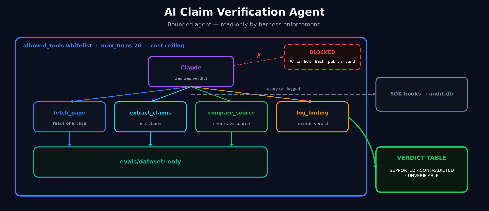

# ai-claim-verification-agent

[](https://github.com/kobescak-kristian/ai-claim-verification-agent/actions/workflows/ci.yml)

Bounded claim-verification agent — verifies factual claims on content pages against source pages; read-only by harness enforcement.

**In plain words:** This agent checks the facts on a page, such as prices, specs and release dates, against other pages that should agree with it. For each fact it says whether the sources support it, contradict it, or cannot confirm it, and it shows which source it used. It can only read: it cannot publish, edit or send anything, and every step it takes is logged so a person can check it later. It passed two official evaluations on synthetic product pages: in July 2026 it got all 35 facts right, and in November 2026 it gave the right answer on all 197 facts of 61 pages it had never seen, in each of 3 runs.

**Status:** v1.1.0 — official evaluation PASS in July 2026 and November 2026 (see [Evaluation history](#evaluation-history)).

## Problem

Affiliate reviews, comparisons, and product pages make factual claims — prices, specs, availability, release dates — that should match their sources but often go unchecked. Doing that check by hand is slow, and it's the first thing skipped when a deadline is close. An AI agent could do the checking instead, but an agent that can act freely near live content is a liability, not a fix: one bad decision and it can publish, edit, or send something it shouldn't.

## Solution

This agent takes one target page and a set of source pages, extracts the target's factual claims, investigates each one against the sources, and logs a verdict — SUPPORTED, CONTRADICTED, or UNVERIFIABLE — with the evidence that produced it. It can provably do nothing else: no writing, no editing, no shell, no network — only four read-only tools over local HTML.



## System

### Input

- One **target page** (the content being checked) and a set of **source pages** (what it's checked against). v1 scope: local, seeded HTML files under `evals/dataset/` — see [Known Limitations](evals/EVAL_RESULTS.md#known-limitations) for what that does and doesn't prove about live web content.
- A **comparison policy** — how to treat numeric mismatches, rephrasing, source authority, and no-coverage claims — loaded from [`evals/eval_config.yaml`](evals/eval_config.yaml) at *runtime*, not copied into the agent's prompt file. The policy lives in exactly one place.

### The Cage

Built on the Claude Agent SDK (Python). The harness — not a README promise — enforces every bound shown in the diagram above:

- `allowed_tools` is exactly the 4 custom in-process MCP tools below; `tools=[]` disables every built-in (no Write, Bash, Edit, Read).
- `max_turns` caps each run at 20 turns.
- A per-run cost ceiling (`max_budget_usd`) plus a tool-call-count circuit breaker in the tool wrapper itself — two independent backstops, one SDK-level, one in-process.
- An SDK `PreToolUse`/`PostToolUse` hook pair writes every tool call to a SQLite audit trail (`audit.db`) *before* its result is used by the model — see [`agent/audit.py`](agent/audit.py). [`tests/test_bounds.py`](tests/test_bounds.py) checks this mechanically against a real run's audit log: every tool-call path resolves inside `evals/dataset/` (with explicit escape-attempt cases asserted rejected), and the fixed eval answer key never appears in any tool input or output.
- Models: Haiku 4.5 for dev iterations, Sonnet 4.6 for eval and demo runs. Runs use the Claude subscription (Max plan) login, not a per-token API key: the harness refuses to start when `ANTHROPIC_API_KEY`, `ANTHROPIC_AUTH_TOKEN`, `ANTHROPIC_BASE_URL`, `CLAUDE_CODE_USE_BEDROCK` or `CLAUDE_CODE_USE_VERTEX` is set, and stops a run unless the CLI's start-up message reports `apiKeySource` none, exactly the 4 tools and the requested model ([`agent/harness.py`](agent/harness.py)).

### Output

A verdict table (claim → verdict → evidence source), one summary line, and a final line reporting run cost and turns used — one screen, no scrollback. Every tool call behind that output is recorded in `audit.db`, independent of what the printed report shows.

### Value

Turns a manual, easy-to-skip check into a single bounded command whose failure mode is "wastes one read-only tool call," never "does something irreversible." The four-tool whitelist and the audit trail mean the bound is checkable after the fact, not just promised up front.

### Tools

The model gets exactly these four in-process MCP tools ([`agent/tools.py`](agent/tools.py)) — all read local HTML under `evals/dataset/` or append to an in-memory findings list; none can write, edit, execute, or reach outside that directory:

| Tool | What it does |
|---|---|
| `fetch_page` | Fetch one local HTML page by path, return its title and paragraphs. Rejects any path outside `evals/dataset/`. |
| `extract_claims` | Return the target page's paragraphs as a numbered list of candidate claims. Deterministic segmentation — the model decides which are worth verifying. |
| `compare_source` | Fetch a source page, framed against a specific claim, and return its full content. Does **not** judge the claim itself — see Key Logic. |
| `log_finding` | Record one claim's final verdict (SUPPORTED / CONTRADICTED / UNVERIFIABLE), the evidence source, and a short note. The only way the agent can "output" anything. |

### Key Logic (high-level)

See [`docs/architecture_detailed.png`](docs/architecture_detailed.png) for the full harness-bounds diagram (tool whitelist, path validator, audit hooks, verification loop).

1. `extract_claims` on the target page produces the candidate claims.
2. For each claim, the model calls `compare_source` (and `fetch_page` as needed) against the relevant source page(s).
3. **The model decides the verdict — no tool computes it.** `extract_claims` does no semantic judgment and `compare_source` does no matching or scoring; both are deterministic fetch-and-frame operations. The model reads the returned page content, applies the comparison policy from its system prompt (numeric claims need exact matches, rephrasing of the same fact is equivalent, authoritative sources outrank forum chatter, no source coverage means UNVERIFIABLE not CONTRADICTED), and reasons to a verdict itself.
4. The model calls `log_finding` once per claim with that verdict, its evidence source, and a note.
5. This is a bounded-execution design (ADR-001): the model chooses its next *read-only investigative* action from the fixed whitelist, within step/turn/cost limits — it never publishes, edits, sends, or makes an irreversible change. A bad decision costs at most one wasted tool call.

## Outcome

### Evaluation history

The agent passed both of its official evaluations. In November 2026 it was tested on 61 previously unseen pages, prepared and sealed apart from its development; every page ran 3 times and was scored against rules fixed in advance. Both evaluations used synthetic pages, not live-web content, and they use different gates and metrics, so their numbers are not directly comparable.

**July 2026: first official evaluation, PASS.** Sonnet 4.6, 2026-07-06 ([full report](evals/EVAL_RESULTS.md)):

| Metric | Value | Threshold | Result |
|---|---|---|---|
| Precision (positive class: CONTRADICTED) | 1.0000 (8/8) | ≥ 0.95 | PASS |
| Recall (positive class: CONTRADICTED) | 1.0000 (8/8) | ≥ 0.90 | PASS |
| Overall verdict accuracy (secondary, not gated) | 1.0000 (35/35) | — | — |

12 cases / 35 claims, $0.9047 total run cost, no case hit `max_turns` or the budget ceiling. A re-run on 2026-10-13, after verdict words were removed from 8 case folder names that reached the model, gave the same result with the same scorer, thresholds and model ([record](evals/rerun_2026-10-13.md)).

**November 2026: Standard evaluation v2, PASS.** Run `ev2-b67b4f30`, Sonnet 4.6, 2026-11-09, on 61 pages with 197 claims ([full report](evals/EVAL_RESULTS.md#standard-eval-v2-official-series)). The evaluation framework is more rigorous than in July:

- **Unseen hold-out.** A separate session that did not build the agent wrote and sealed the pages; they were added only after the agent was frozen, and the answer key's hash was checked against its frozen value before the run.
- **Page reliability.** A page passes only if none of its 3 runs makes a serious error, such as calling a false claim true or not finishing.
- **Rules fixed first.** Thresholds and grading rules ([`evals/eval_config_v2.yaml`](evals/eval_config_v2.yaml)) were committed before any official result.
- **Evidence and isolation checks.** A SUPPORTED or CONTRADICTED verdict earns credit only with a valid source from the page's own folder, and every run had to report `apiKeySource` none and exactly the 4 tools at start-up.

| Gate | Result | Threshold |
|---|---|---|
| Pages passed | 61/61 | at least 59 |
| Unnecessary UNVERIFIABLE | 0/504 (0.00%) | at most 5% |
| Useful verification (right verdict, valid source) | 504/504 (100.00%) | at least 80% |

Gates 2 and 3 assess the 168 SUPPORTED or CONTRADICTED claims across three runs (504 assessments).

All 183 runs (61 pages x 3) completed, with 100% verdict and evidence accuracy. The hold-out follows the same case rules as the development pages, so the gain over July is in how rigorously the agent is tested, not in harder individual claims ([scope and limits](evals/EVAL_RESULTS.md#standard-eval-v2-scope-and-limits)).

**Out of scope (production upgrades)** — deliberately not built and with no trigger yet: live-web crawling at scale, multi-agent teams, subagents, dashboards, scheduled runs, auto-fixing content.

## Run It Yourself

```bash
python -m venv .venv
.venv/Scripts/activate   # or: source .venv/bin/activate  (macOS/Linux)
pip install -r requirements.txt
```

Live runs need a Claude subscription login through the Claude CLI. API-key authentication is not supported (see [The Cage](#the-cage)).

**Tests** (no model call; CI runs them on pushes and pull requests to `main`). Two audit checks need a local `audit.db` and are skipped without one:

```bash
pytest tests/ -v
```

**Re-score the Standard v2 official result** (offline, no model call):

```bash
python evals/score_v2.py evals/results/v2/official/ev2-b67b4f30.json
```

**Single-case demo** (live model run):

```bash
python run_case.py case_09
```

Expected output shape: a claim-by-claim verdict table (SUPPORTED / CONTRADICTED / UNVERIFIABLE + evidence source), a one-line summary, and a final line with run cost and turns used.

**Legacy v1 evaluation** (all 12 cases / 35 claims, live model runs):

```bash
python evals/run_eval.py
```

The committed reference result is [`evals/results/eval-05fbe4ee.json`](evals/results/eval-05fbe4ee.json), summarized in [`evals/EVAL_RESULTS.md`](evals/EVAL_RESULTS.md) — compare a fresh run against it rather than trusting either run in isolation.

**Standard eval v2 runner** (live model runs; start it from a plain terminal, because it refuses to run inside a Claude Code session):

```bash
python evals/run_eval_v2.py --set dev
```

This runs the 12 development pages 3 times each; the result is labelled DEV ONLY. The official series used `--set official --key-sha256 <frozen key hash>`. Any new run on the official pages is a regression test, not a fresh unseen evaluation.

## Related

This agent was also ported to LangGraph, facing the identical frozen eval: [ai-claim-verification-langgraph](https://github.com/kobescak-kristian/ai-claim-verification-langgraph), parity result precision 1.00 / recall 1.00 (2026-07-20); its re-run with neutral case names (2026-10-13) also scored 1.00 / 1.00. See that repo's [`COMPARISON.md`](https://github.com/kobescak-kristian/ai-claim-verification-langgraph/blob/main/COMPARISON.md) for what the framework gives, hides, and cannot enforce versus this hand-rolled version.

## Version Log

| Version | Date | Change |
|---|---|---|
| v1.0 | 2026-07-06 | Initial release: bounded harness + 4 MCP tools, eval-gated (Sonnet 4.6 — precision 1.00, recall 1.00 on 12 cases / 35 synthetic claims), audit-trail regression tests, architecture diagram. |
| v1.0.1 | 2026-07-09 | Repro instructions added pre-flip: Run It Yourself section (proven from a fresh clone), SPEC.md and detailed-diagram links. |
| v1.0.2 | 2026-07-20 | Related section added, cross-linking the LangGraph port (`ai-claim-verification-langgraph`) and its framework-comparison writeup. |
| v1.0.3 | 2026-10-13 | Eval case directories renamed to neutral `case_01` to `case_12` (8 of 12 old names contained a verdict word that reached the model); bounds test added for verdict words in dataset names; frozen eval re-run: precision 1.00 / recall 1.00, 35/35. |
| v1.0.4 | 2026-10-29 | Plain-language summary added under the title. EVAL_RESULTS corrected: the audit-trail note now names the existing `tests/test_bounds.py`, and two references to the retired SPEC.md are updated. |
| v1.1.0 | 2026-11-09 | Standard evaluation v2: official PASS on 61 sealed synthetic pages, 3 runs each (`ev2-b67b4f30`), with its own gate, scorer and runner. The harness refuses API-key and other guarded auth variables and checks `apiKeySource`, tools and model at start-up; failed tool calls are recorded in the audit trail. The v1 gate and results are unchanged. |
